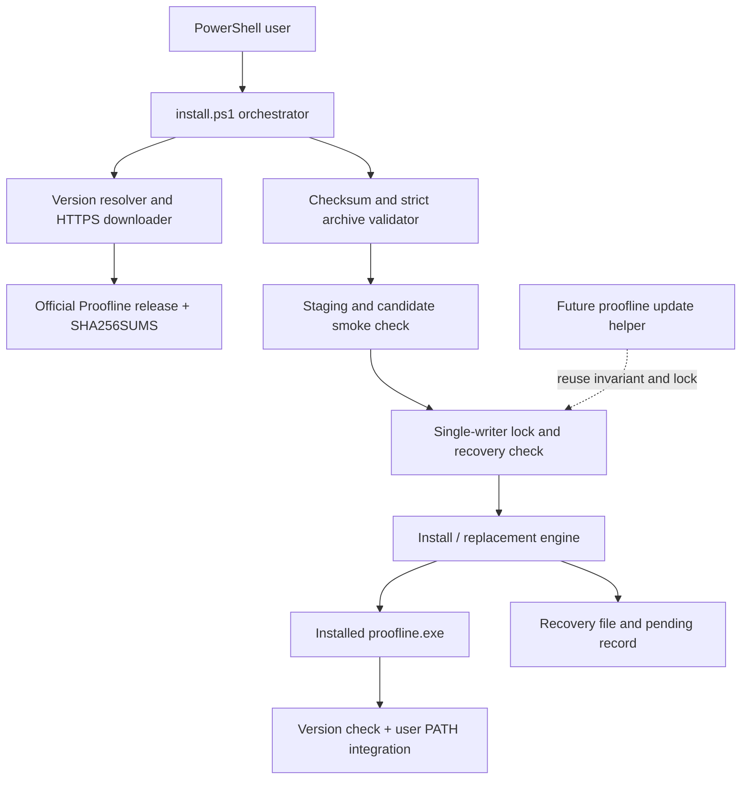
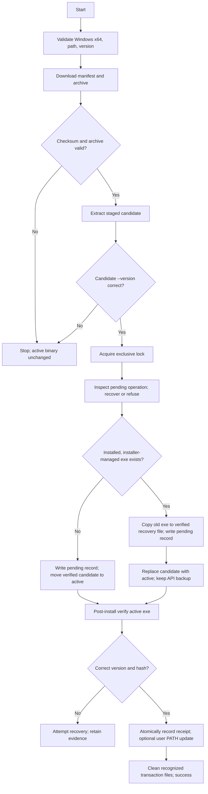
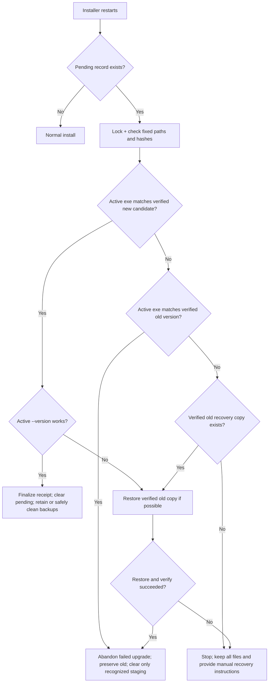

# Windows installer architecture — proposed design

> **Status:** design proposal / not yet implemented or validated on Windows.  
> **Reviewed:** 2026-11-23. **Branch:** `ThunderKhan/cli:feat/windows-install-update`.  
> This is internal engineering documentation, not the final upstream PR documentation. Validate decisions with Windows experiments and maintainers before claiming production readiness.

## 1. Problem, goal, and boundaries

**Observed upstream limitation:** Proofline distributes `proofline.exe` in `proofline-x86_64-pc-windows-msvc.tar.gz`, but `README.md` requires Windows users to download, hash-check, extract, install and update it manually. The Unix `install.sh` and Rust `src/update.rs` do not offer native Windows installation/update at the inspected base commit `4d494f67dab0028c2e2a96e6a8bd2a44b3b0216b`.

**Goal:** a secure, convenient **PowerShell installer** (`install.ps1`) using Proofline's existing signed-over-HTTPS release distribution and SHA-256 manifest, with a recoverable upgrade path. Preserve a verified old installation when errors occur; never claim that power failures or arbitrary hardware faults are impossible.

**Now:** Windows x64, user-scope install, install/reinstall/installer-driven upgrade, safe PATH handling, deterministic tests. **Later, separately:** native `proofline update` on Windows using a child updater/helper after the CLI exits.

**Not now:** MSI/GUI/WinGet/Scoop packaging; Windows ARM64; automatic admin elevation; background service; rewriting Unix updater; an official hosted installer URL without maintainer approval.

### Source examples and what we learned

| Project | Architectural lesson | What we will not assume |
| --- | --- | --- |
| Deno's `install.ps1` | a small PowerShell downloader is sufficient to install a prebuilt CLI | downloading/extracting directly into final path is failure-safe |
| uv's Windows self-update | backup previous exe, call an external installer, restore after reported failure | a catch/restore handler runs after a process kill or power loss |
| Scoop | version folders + stable `current` junction can separate preparation from activation | junction replacement is necessarily uninterrupted/atomic |
| Rustup Windows updater | separate updater waits for the running executable and coordinates via a lock | Proofline needs the same heavyweight updater machinery for first install |
| Microsoft `ReplaceFileW` / .NET `File.Replace` | in-place replacement can use one API and optionally preserve a backup | it is crash-proof, succeeds for running executables, or never leaves intermediate states on error |

References at the end link to inspected sources and primary Windows APIs.

## 2. Component responsibilities



- **Orchestrator:** script arguments, readable status/error messages, cleanup.
- **Release client:** numeric version validation; fixed official HTTPS origin; bounded downloads, timeouts and redirects; no user-provided executable URLs in production.
- **Verifier:** strict matching SHA256SUMS entry and member inspection of tar.gz; avoid unsafe extraction before verifying paths, types and sizes.
- **Staging:** build an executable candidate away from the active path; invoke `--version` only after verification.
- **Commit/recovery:** single-writer lock, durable pending record, previous executable preservation, post-install validation.
- **PATH:** only after executable succeeds; write **User** PATH (never system PATH), avoid duplicates; provide `-NoModifyPath`.

For deterministic tests, make download, filesystem operations and CLI version checks injectable behind small PowerShell functions. **No test-only arbitrary download-origin override in the published installer.**

## 3. Proposed local files

Default (proposal, not confirmed upstream policy): `%LOCALAPPDATA%\Programs\Proofline\bin`. `PROOFLINE_INSTALL_DIR` may explicitly override with an **absolute** safe directory, subject to the ownership/reparse-point checks.

```text
%LOCALAPPDATA%/Programs/Proofline/bin/
  proofline.exe                         # active command
  .proofline-install.lock               # stable lock file; never remove during normal use
  .proofline-install.receipt.json       # installer-managed metadata
  .proofline-install.pending.json       # exists during pending/recoverable upgrade
  .proofline-candidate-<id>.exe         # validated staged new image (temporary)
  .proofline-recovery-<id>.exe          # independently copied + checked old image (upgrade only)
  .proofline-api-backup-<id>.exe        # optional backup produced by replacement API
```

One random operation ID per install. The persistent record contains operation ID, fixed relative file names, expected old and new SHA-256 hashes, exact version and operation phase. Validate its schema and size. **Never use arbitrary file paths from a pending record** to delete/execute user files. No credentials or auth tokens are stored.

Use one validated install root throughout a transaction; do not follow unexpected symlinks, junctions/reparse points or overwrite an unmanaged `proofline.exe`. Source code and tests must check those operations against real Windows semantics. A non-install-owned existing executable requires an explicit handover policy; the initial safe behavior is to refuse overwrite with guidance.

## 4. Happy path: new installation and upgrade



**Ordering is the key:** downloaded bytes are checked before execution; the currently installed exe is left untouched until candidate is ready. On upgrade, preserve a verifiable old copy **before** attempting replacement. The pending record is stored **before** mutating the active path. Same-volume staging is necessary for the intended file-replacement operations.

For a new install where no `proofline.exe` exists, move the verified candidate into position and verify. If the process stops before writing the receipt, the pending record allows the next installer run to identify the candidate.

For an existing installer-managed installation, prefer evaluating .NET `[IO.File]::Replace(candidate, active, apiBackup)` on Windows PowerShell 5.1 and PowerShell 7, with `candidate`, `active`, `apiBackup` on the same volume. **This API is not a blanket atomicity guarantee:** Microsoft documents errors where files end up with changed names. The separately verified recovery copy provides an additional fallback. Keep any unknown/conflicting files instead of deleting them.

Use best-effort flushes for staged/recovery files and pending metadata before the switch, but do **not** promise recovery from arbitrary power loss without physical testing. `ReplaceFileW` does not support `REPLACEFILE_WRITE_THROUGH`.

## 5. Crash recovery design

The next installer invocation acquires the same lock and inspects the pending record **before starting a new operation or deleting leftovers**. It decides based on actual file presence, matching SHA-256 hashes and safe smoke checks, not just an old phase flag.



| Observed after failure | Required behavior |
| --- | --- |
| Failure before installation mutation | Old executable/hash/PATH unchanged |
| Old still active + pending | Keep old; remove only verified transaction artifacts |
| New active, matches target digest, runs | Finalize recorded new version; clean only verified extras |
| Active missing/invalid, verified recovery available | Restore old and verify; otherwise preserve files and report |
| Replacement refused due to executable lock | Abort safely; do not force kill user processes |
| Unknown files or digest mismatch | **Stop**, preserve evidence; never overwrite/delete an unrelated file |
| Two cooperating installers | Stable exclusive lock prevents concurrent commit; bounded wait or clear failure |
| Power failure leaves inconsistent disk state | Best-effort recovery on **rerunning installer**; no automatic recovery on normal `proofline` invocation if the exe is missing |

A file lock held using a cross-process exclusive Windows file handle (`FileShare.None`) can coordinate installer processes; Windows releases the handle after process exit. Keep the lock pathname stable, and do not delete it between operations. A future CLI updater must participate in the **same** locking protocol. An exclusive lock prevents *cooperating* installers racing; it does not stop unrelated software from modifying files.

Rollback must also be able to fail (e.g. permission errors or antivirus holding a file). In that case, preserve the old copy and tell the user how to repair/retry; never report success.

## 6. Integrity and trust invariants

1. Downloads are from supported official HTTPS locations, with validated redirects, TLS and bounded lengths. Resolve published version deliberately, never trust an arbitrary URI supplied by an error-prone environment variable.
2. Exactly one valid SHA-256 manifest entry matches the release archive; no duplicate, malformed or missing digest accepted.
3. Before extraction: verify archive digest, tar member count/name/type, size bounds and no traversal, links or unexpected metadata. Extraction must not escape the staging directory.
4. Never execute an unverified downloaded candidate. After verification, smoke-check exact `proofline <version>`, with update checks disabled and an explicit timeout.
5. Check installed paths are not unexpected symlinks or Windows reparse points; refuse unmanaged targets; use user-owned installation and never elevate for normal installs.
6. Every mutating operation that can affect `proofline.exe` is serialized; old version preserved until a new version is verified.
7. Keep backup/record until new active executable and receipt are confirmed. Avoid destructive rollback when state is ambiguous.
8. Integrity from SHA-256 is **relative to downloaded SHA256SUMS**. If attacker replaces both, a matching hash is not independent publisher authentication. Review the provenance work in upstream PRs #72/#73 before adding a second supply-chain implementation.

## 7. Install and CLI-update lifecycle: intentional boundary

The PowerShell installer can update an **idle** installed exe because the script is running as a separate process. If replacement is denied (including a running program/handle), report it and preserve the old installation.

A later `proofline update` runs from inside the currently active `proofline.exe`. It should **not** overwrite its own image. The intended future design is to have Rust download and verify release data, hand off to an independently running helper or the trusted installer, exit, then let the helper take the **same lock**, re-validate, replace, and report/recover. This is a separate project milestone, not a feature implicitly delivered by `install.ps1`.

```mermaid
sequenceDiagram
    participant User
    participant CLI as Running proofline.exe
    participant Helper as Future updater helper
    participant Disk as Installed files
    User->>CLI: proofline update
    CLI->>CLI: Select + verify new release
    CLI->>Helper: Start trusted helper with verified candidate
    CLI-->>User: Exit / handoff status
    Helper->>Helper: Wait for CLI to exit; acquire install lock
    Helper->>Disk: Stage backup, pending record, replace
    Helper->>Disk: Verify; finalize or recover
    Note over User,Disk: Future milestone — not implemented by this installer
```

## 8. PATH and user experience

- One-command installation should make the CLI discoverable: update **User PATH** after successful installation, disclose the change, and support `-NoModifyPath` for CI/user preference.
- Add the directory once with case-insensitive normalized path comparison, without overwriting or expanding unrelated PATH entries; update process PATH for immediate use and tell the user when a new terminal is needed.
- Confirm `Get-Command proofline` resolves the expected executable; warn clearly if another earlier PATH entry shadows it. Do not delete/modify the other install.
- If PATH persistence fails after a verified install, report **"binary installed; PATH setup failed"**, print exact manual steps, and do not pretend the entire operation succeeded or delete a healthy installed executable.
- Avoid `Set-ExecutionPolicy`, registry machine PATH and admin prompts. Final hosted one-liner/endpoint is subject to upstream publication and trust review.

## 9. First tests and design gates

Before implementation, capture the README's manual Windows process using a published release: shell version, release archive, checksum, `proofline --version`, PATH behavior. That is the **baseline**.

| Acceptance test | Evidence |
| --- | --- |
| Fresh install, repeat install, explicit version | Correct digest/version/path; no duplicates |
| Broken HTTPS/download, missing/duplicate/wrong checksum | Old exe byte-for-byte unchanged |
| Archive with traversal/link/unexpected entry/oversize | Rejected before executable touches target |
| Candidate smoke check fails | Old exe remains |
| Locked running exe | Safe documented refusal; old still works |
| Access denied / disk full | No silent partial upgrade; recovery path |
| Inject failure before/inside/after replacement | On retry, inspect pending and finalize or restore |
| Concurrent installers | Only one serialized commit |
| PATH failure, existing different `proofline` on PATH | Clear report and no unrelated file changes |
| PowerShell 5.1 + 7, spaces/Unicode in path | Native Windows CI evidence |
| Real published archive installation | End-to-end official release verification |

**Unresolved architecture gates before coding:**
1. Verify .NET `File.Replace` behavior on `windows-2025` (including locks and special failure codes) with sacrificial executables, not the real user install.
2. Confirm default install path policy, initial unmanaged-install refusal and custom path rule.
3. Decide the release default (published `latest` vs script-pinned version), and whether the hosted installer can be distributed alongside existing R2/GitHub assets.
4. Specify exact testable journal schema, commit-point semantics, and recovery failure messages.
5. Validate PowerShell 5.1 + 7 behavior and upstream provenance PR interactions.

## 10. Implementation order and PR scope

1. Baseline reproduction and Windows replacement experiments. Record commands and outcomes in `test-plan.md`.
2. Write acceptance tests for validators and recovery classification using local fixtures.
3. Implement minimal installer components (download/verify/stage).
4. Implement locked install/replace/recovery and PATH behavior; fault-inject and fix.
5. Add Windows installer CI, README usage, and only release-publishing changes maintainers accept.
6. Run Proofline review, record accepted/rejected findings, produce PR and short video.
7. Discuss/implement Windows `proofline update` **only after** the installer foundation is validated, with a separate scope decision.

Keep commits few and meaningful; do not automatically rewrite pushed history on failed tests. The internal `docs/windows-install-update/` files may be removed or condensed before the upstream PR, but reproducibility and decisions belong in the final PR.

## 11. Primary sources

- Proofline: [README](https://github.com/prooflinedev/cli/blob/main/README.md), [install.sh](https://github.com/prooflinedev/cli/blob/main/install.sh), [update.rs](https://github.com/prooflinedev/cli/blob/main/src/update.rs), [archive.py](https://github.com/prooflinedev/cli/blob/main/scripts/archive.py), [CI](https://github.com/prooflinedev/cli/blob/main/.github/workflows/ci.yml), [release workflow](https://github.com/prooflinedev/cli/blob/main/.github/workflows/release.yml)
- [Deno PowerShell installer](https://github.com/denoland/deno_install/blob/master/install.ps1)
- [uv self-update implementation](https://github.com/astral-sh/uv/blob/main/crates/uv/src/commands/self_update.rs)
- [Scoop current-version alias](https://github.com/ScoopInstaller/Scoop/wiki/The-%27Current%27-Version-Alias), [Scoop installation code](https://github.com/ScoopInstaller/Scoop/blob/master/lib/install.ps1)
- [Rustup Windows replacement](https://github.com/rust-lang/rustup/blob/main/src/cli/self_update/windows.rs)
- [Microsoft ReplaceFileW](https://learn.microsoft.com/en-us/windows/win32/api/winbase/nf-winbase-replacefilew), [.NET File.Replace](https://learn.microsoft.com/en-us/dotnet/api/system.io.file.replace?view=netframework-4.8.1), [MoveFileExW](https://learn.microsoft.com/en-us/windows/win32/api/winbase/nf-winbase-movefileexw)
- [Microsoft Mutex semantics](https://learn.microsoft.com/en-us/dotnet/standard/threading/mutexes), [PowerShell environment variables](https://learn.microsoft.com/en-us/powershell/module/microsoft.powershell.core/about/about_environment_variables)

**Reality check:** This document is a *proposed* architecture. It explains how we intend to prevent and recover from failure, not evidence that all operations are atomic or already pass tests.
